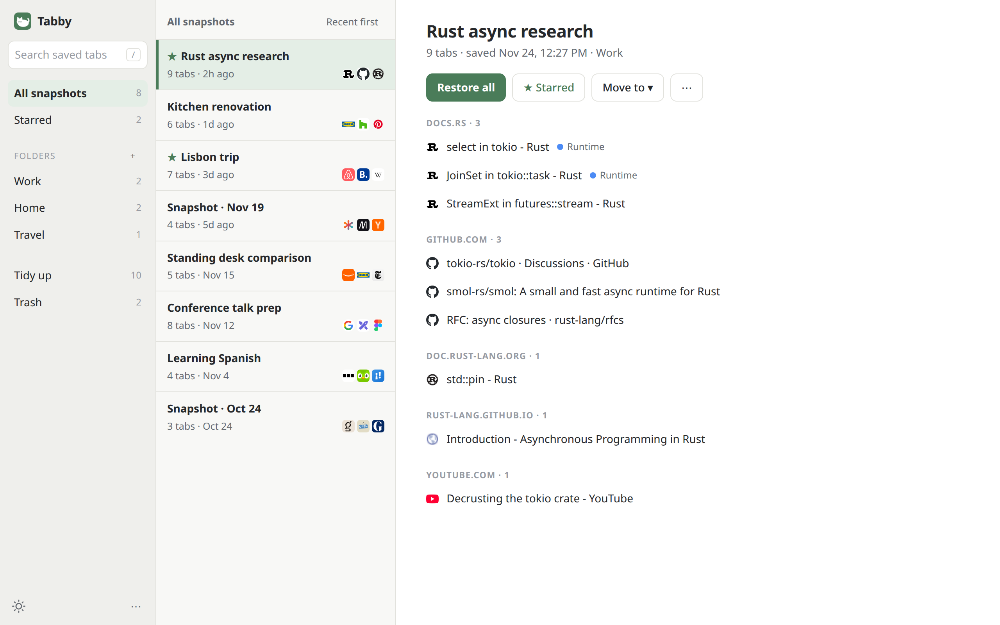
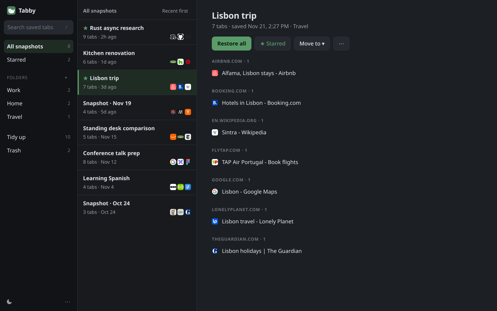
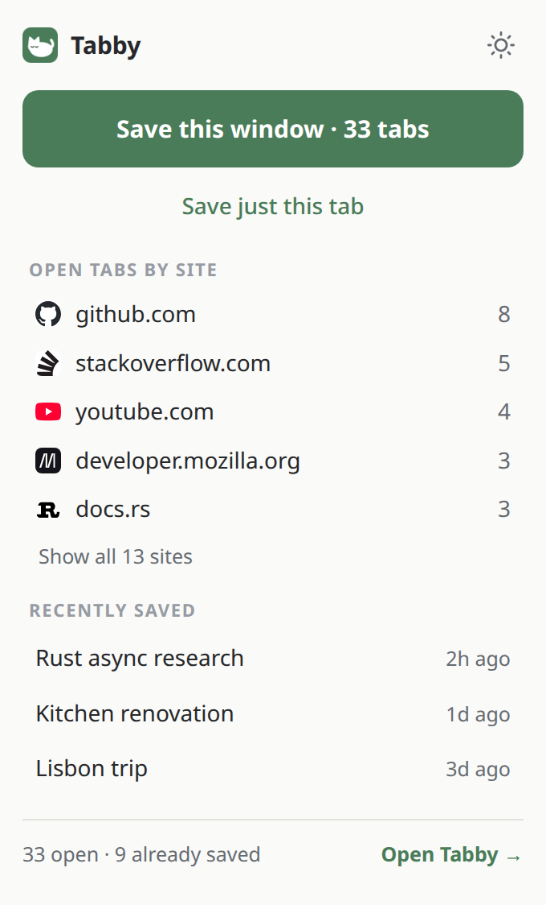
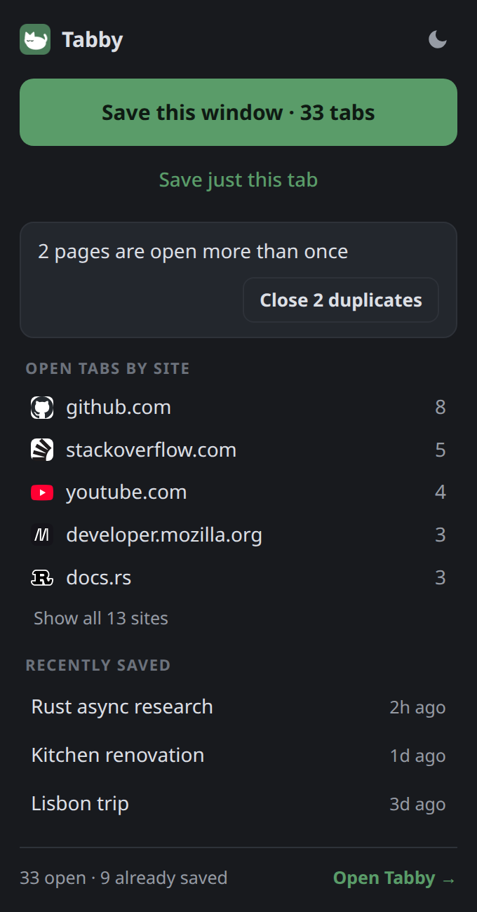
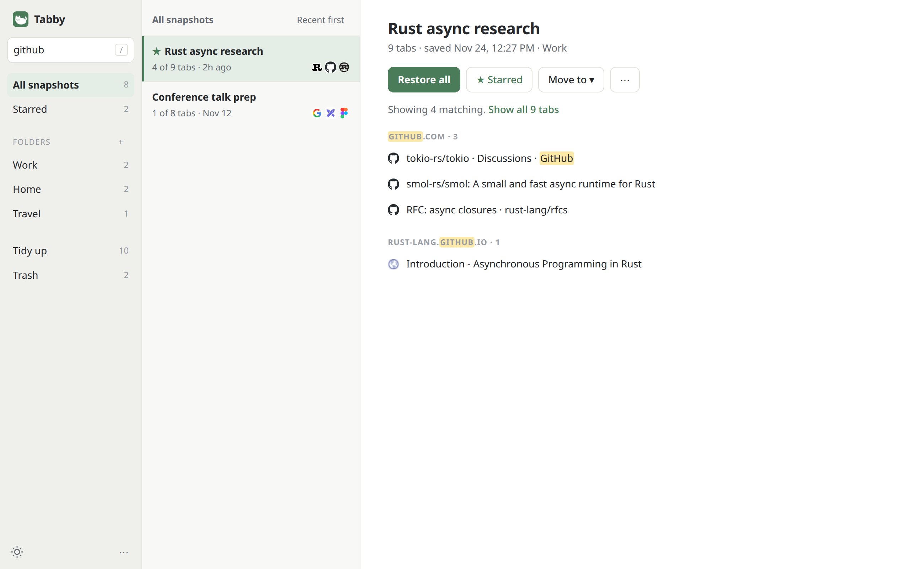
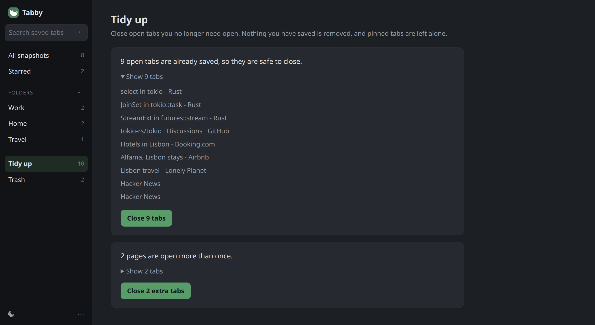

# Tabby

Tabby is a local-first browser extension that turns open tabs into a calm,
searchable memory system. It treats tabs as unfinished thinking, not clutter.

If you keep dozens (or hundreds) of tabs open because they represent research,
ideas, or tasks in-progress, Tabby helps you capture that context without guilt
and retrieve it later.

## Why Tabby

Most tab managers are good at emergency storage but weak at retrieval. They
store flat lists of links with little context, which makes it hard to find what
you saved. Tabby focuses on:

- Context preservation (snapshots of mental state)
- Domain-aware organization
- Fast search and retrieval
- ADHD-friendly defaults
- Local-only storage, no accounts

## Features

- Save the current tab or window as a snapshot, from the popup or the right-click menu
- Library page with three panes: places, snapshots, and the selected snapshot's tabs
- Search by title, domain, or URL
- Folders and stars
- Open a saved tab with one click; it moves to Trash, with Undo
- Restore a whole snapshot, including its Chrome tab groups
- Tidy up: close open tabs that are already saved or open more than once
- Trash with restore and empty controls
- Export and import (JSON)

## Screenshots

The Library: places on the left, snapshots in the middle, the selected
snapshot's tabs on the right.





The popup: save the current window or tab, and see which sites your open
tabs belong to.

<p>
  
  
</p>

Search across every saved tab by title, site or address.



Tidy up: close open tabs that are already saved, or open more than once.



The screenshots use made-up sample data.

## Install (Unpacked)

1. Open `chrome://extensions` (or `brave://extensions`).
2. Enable **Developer mode**.
3. Click **Load unpacked** and select this repository folder.
4. Pin Tabby to the toolbar for quick access.

## Usage

1. Click the Tabby icon and choose **Save this window** or **Save just this tab**.
   The same actions are in the page's right-click menu.
2. Choose **Open Tabby** to browse, search, and restore what you saved.
3. Use **Tidy up** to close open tabs that are already saved.

## Privacy & Security

- No backend, no accounts, no cloud sync.
- All data is stored locally using `chrome.storage.local`.
- The extension requests no host permissions and sends your data nowhere.
- Site icons shown next to saved tabs are loaded from the addresses your
  browser recorded for them, so displaying a saved tab's icon contacts
  that site.

## Architecture

High-level flow:

Browser Tabs → Snapshot Engine → Local Storage → Library UI

Key decisions:

- Local-only storage for transparency and user control
- JSON data model for inspectability and backups
- No network access: the extension requests no host permissions

See `docs/ARCHITECTURE.md` and `docs/DATA_MODEL.md` for details.

## Project Structure

```
.
├─ background/        # Service worker modules (save actions, context menus)
├─ docs/              # Vision, principles, architecture, data model, roadmap
├─ icons/             # Extension icons
├─ lib/               # Pure helper utilities (urls, domains, dates)
├─ library/           # Library page modules (model, render, actions, tidy, settings)
├─ site/              # The landing page at tabby.tickshift.dev (not part of the extension)
├─ storage/           # Local storage layer (snapshots, folders, trash)
├─ tests/             # Node tests for the pure logic and storage layer
├─ background.js      # MV3 service worker entry
├─ manifest.json      # Extension manifest
├─ popup.html         # Popup UI
├─ popup.js           # Popup logic
├─ library.html       # Library page
├─ wrangler.jsonc     # Publishes site/ as the landing page
└─ README.md
```

## Roadmap

Tabby’s roadmap is documented in `docs/ROADMAP.md`. Highlights include:

- Search and filtering improvements
- Parked for now, to return later: tags, notes and topics

## Development Notes

- Manifest V3 extension (Chrome/Chromium-based browsers).
- No build step required.
- UI assets live in `popup.*`, `library.*` and `library/`.
- Run the tests with `node --test tests/` (no dependencies to install).
- `site/` and `wrangler.jsonc` are the landing page, not the extension. Leave them, `docs/` and
  `tests/` out of any zip you upload to an extension store.

## Contributing

Issues and PRs are welcome. Please keep changes aligned with the core principles
in `docs/CORE_PRINCIPLES.md` and the UX guidelines in `docs/UX_PRINCIPLES.md`.

## License

MIT. See `LICENSE`.
